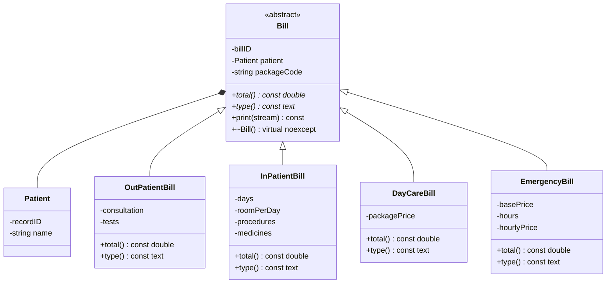
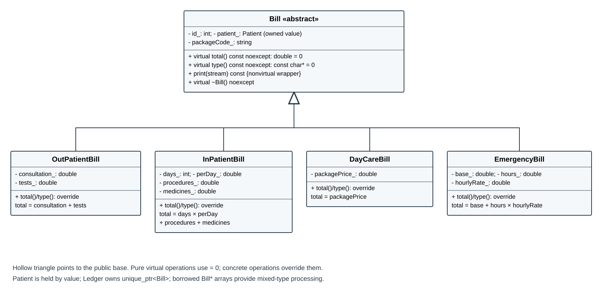

# Bill UML

total/type are pure virtual in Bill and overridden in every concrete type. print is a shared nonvirtual wrapper. Generalization denotes public inheritance; the composition diamond denotes the owned Patient value. Asterisks denote abstract operations in this Mermaid notation. The standalone SVG version was rendered and visually reviewed.

