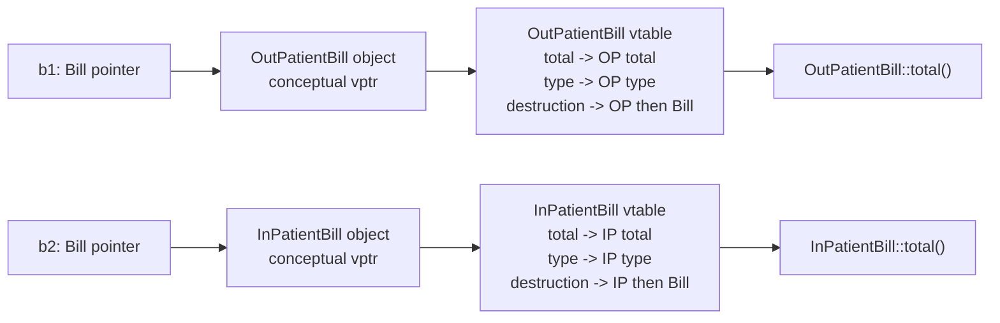

# Conceptual vtables and dispatch

These tables describe a common implementation technique for the planned A1 hierarchy. The C++ standard does not require a vptr, a particular object layout, these slot numbers, a specific table order or even this implementation strategy. Compilers may add RTTI, adjustment thunks and several destructor entries. Abstract Bill cannot be instantiated as a complete object.

| Conceptual interface operation | Abstract Bill table | OutPatientBill table | InPatientBill table |
|---|---|---|---|
| total() | pure virtual entry | OutPatientBill::total | InPatientBill::total |
| type() | pure virtual entry | OutPatientBill::type | InPatientBill::type |
| virtual destruction | Bill destructor role | complete OutPatientBill destruction | complete InPatientBill destruction |
| print(stream) | Nonvirtual wrapper, no virtual slot required | inherited wrapper calls virtual operations | inherited wrapper calls virtual operations |

At a non-devirtualized `b->total()` call, the common implementation follows the object's virtual-table pointer and invokes the selected slot, with any required pointer adjustment. The static Bill* type admits the interface call; the dynamic object type chooses the final overrider. The exact supplied prediction program is a smaller model: it has total/destruction but no type() operation. Its nonvirtual show() wrapper still reaches OPBill::total().
