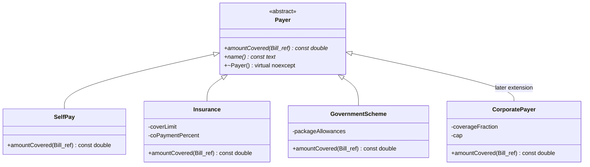
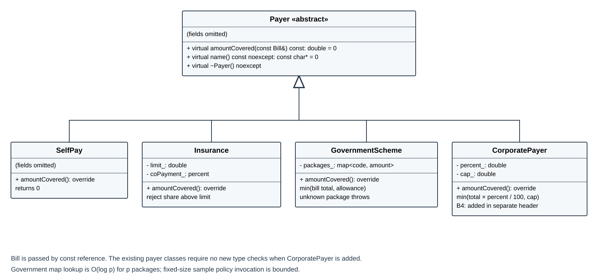

# Payer UML

All inheritance is public. amountCovered is pure virtual in Payer and overridden in the concrete classes. CorporatePayer is planned here and implemented separately in B4; no existing payer implementation requires a new case or type check.

