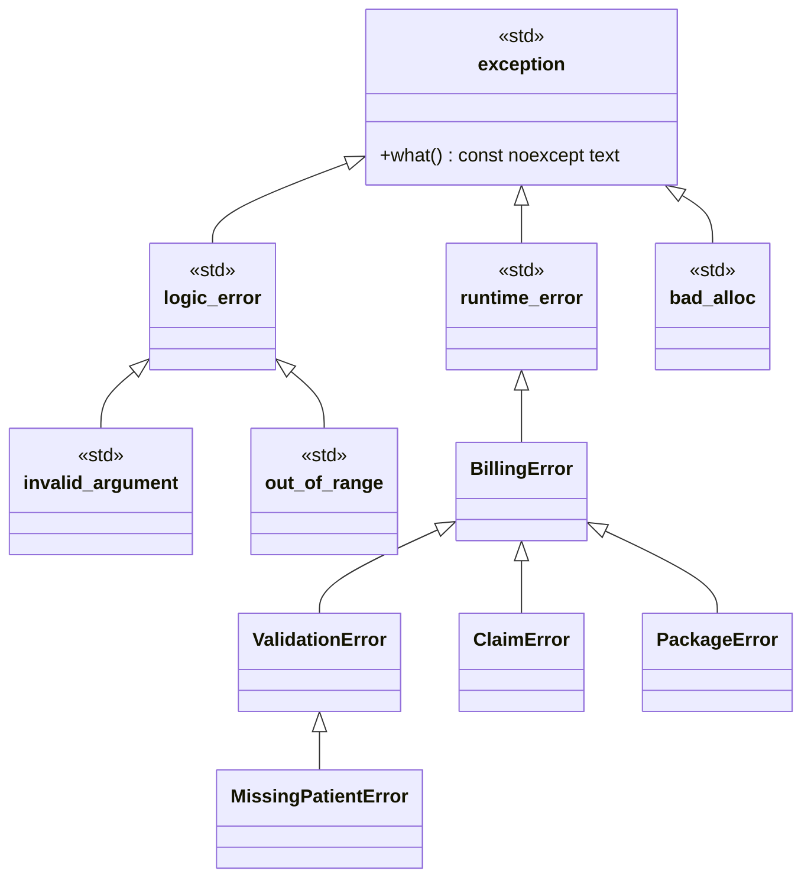
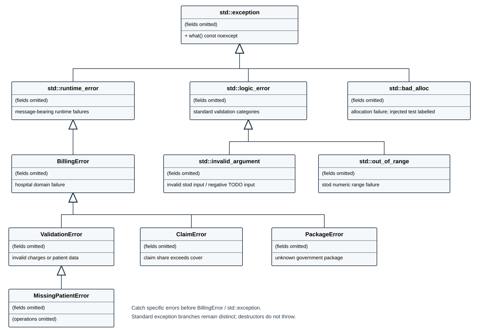

# Exception UML

Standard-library branches remain distinct from the custom billing hierarchy. Catch the most specific types before BillingError/std::exception, then a final catch-all. bad_alloc is not converted into an invented successful claim.

